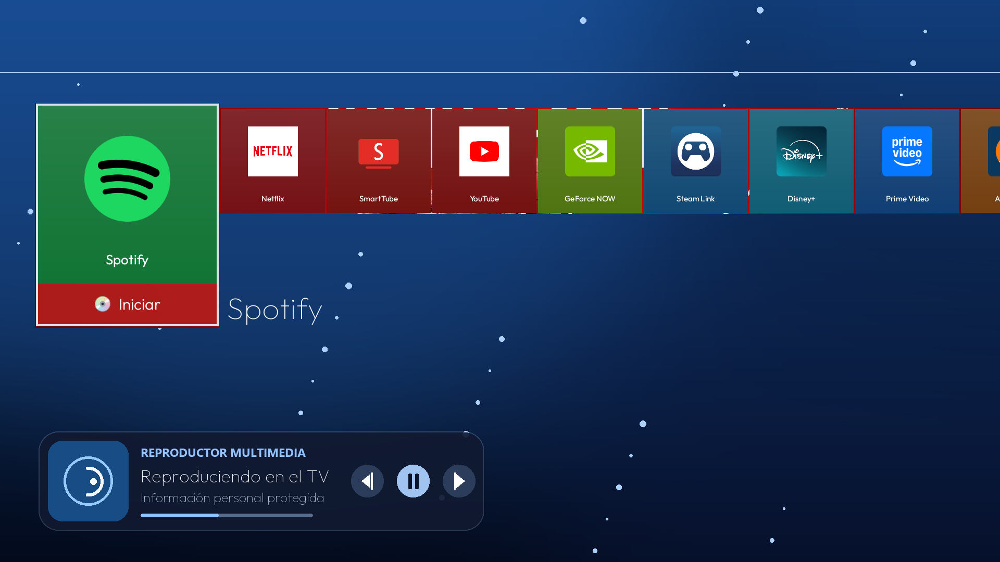
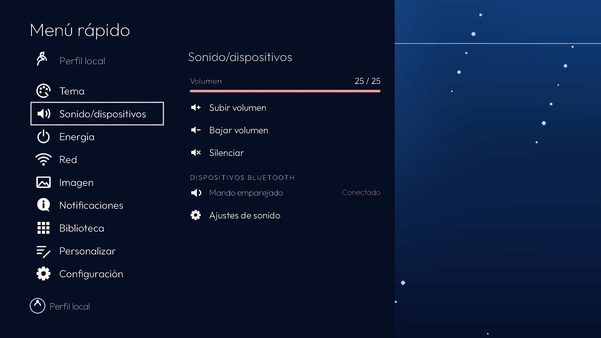
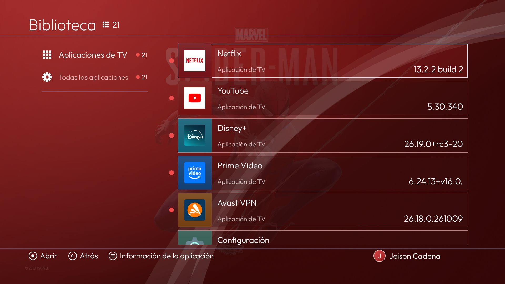
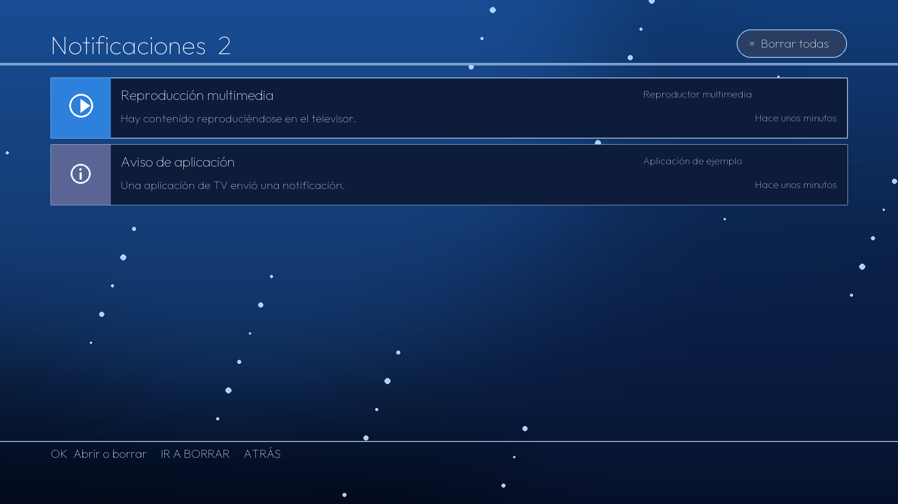
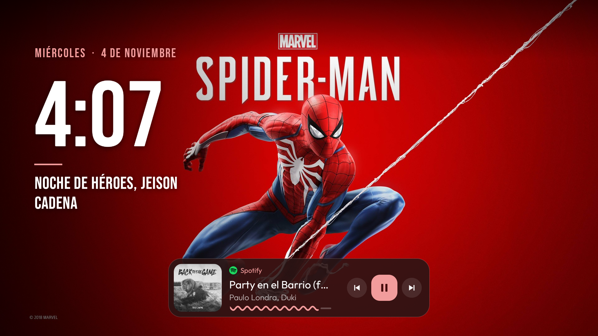

<p align="center">
  
</p>

<h1 align="center">Launcher Android TV con interfaz inspirada en PS4</h1>

<p align="center">
  Un inicio para Android TV y Google TV, navegable con el control remoto y personalizable con tus aplicaciones, fondo y colores.
</p>

<p align="center">
  <a href="https://github.com/JeisonCadenaC/cleanyourtv-PS4theme">Repositorio de este fork</a> ·
  <a href="docs/ps4-theme.md">Guía detallada</a> ·
  <a href="https://github.com/Gathin23/CleanYourTV">Proyecto base CleanYourTV</a>
</p>

> **Este es un fork independiente de CleanYourTV**, mantenido por [JeisonCadenaC](https://github.com/JeisonCadenaC).
> La modificación principal es un modo de inicio opcional inspirado en la navegación de PlayStation 4.
> No es software de Sony, no ejecuta juegos de PS4 y no se conecta a PlayStation Network.

> **Idioma:** este README en español es la documentación específica del fork. Los README en otros idiomas que
> aparecen abajo se heredaron de CleanYourTV y aún no describen la interfaz PS4 de esta versión.

<p align="center">
  Leer las traducciones heredadas:
  <a href="README.zh-CN.md">简体中文</a> ·
  <a href="README.zh-TW.md">正體中文</a> ·
  <a href="README.vi.md">Tiếng Việt</a> ·
  <a href="README.ja.md">日本語</a> ·
  <a href="README.it.md">Italiano</a> ·
  <a href="README.pt-BR.md">Português</a> ·
  <a href="README.nl.md">Nederlands</a> ·
  <a href="README.de.md">Deutsch</a> ·
  <a href="README.uk.md">Українська</a> ·
  <a href="README.tr.md">Türkçe</a>
</p>

## Qué es este proyecto

Este repositorio conserva el launcher Android TV de [CleanYourTV](https://github.com/Gathin23/CleanYourTV) y
añade una presentación opcional de pantalla completa, tarjetas de aplicaciones y menú rápido con estética
inspirada en PS4. Está pensado para navegar desde el sofá con las flechas, OK y Atrás del control remoto.

La interfaz PS4 no se activa para todos por defecto. Se habilita en un tema con `ps4_layout: true`; los temas
que no incluyan esa opción conservan la pantalla estándar del launcher. El modo PS4 no convierte el televisor
en una consola ni modifica, instala o emula juegos.

## Capturas

Las capturas muestran el launcher en ejecución en Android TV. Antes de publicar imágenes, asegúrate de que
no revelen datos personales, redes Wi-Fi o notificaciones privadas, y de que los fondos y recursos visuales
sean propios o tengan licencia para redistribuirse. Los iconos de aplicaciones visibles pertenecen a esas
aplicaciones y conservan sus marcas.

<table>
  <tr>
    <td width="50%" valign="top">
      
      <p align="center"><strong>Menú rápido</strong></p>
    </td>
    <td width="50%" valign="top">
      
      <p align="center"><strong>Biblioteca</strong></p>
    </td>
  </tr>
  <tr>
    <td width="50%" valign="top">
      
      <p align="center"><strong>Notificaciones</strong></p>
    </td>
    <td width="50%" valign="top">
      
      <p align="center"><strong>Protector de pantalla</strong></p>
    </td>
  </tr>
</table>

La pantalla de inicio está al comienzo de esta página. La tarjeta inferior es el reproductor multimedia de
Android; solo aparece si el sistema expone una sesión multimedia activa. Cambia `screen-protector-propia.png`
por una captura que tengas derecho a publicar.

## Funciones

| Área | Qué hace |
|---|---|
| **Inicio** | Presenta las aplicaciones de TV en una fila horizontal; la aplicación enfocada crece y muestra acciones para abrirla y consultar su información. |
| **Navegación** | Usa el foco y las teclas de dirección del control remoto; no requiere pantalla táctil. |
| **Menú rápido** | Agrupa perfil local, tema y acento, volumen y dispositivos Bluetooth, energía, red, imagen, notificaciones, personalización y configuración del televisor. |
| **Biblioteca** | Muestra las aplicaciones de TV y permite recorrer también las aplicaciones iniciables que no declaran una actividad de Android TV. |
| **Notificaciones** | Permite ver y borrar notificaciones mediante acceso opcional de Android. |
| **Reproducción** | Muestra controles y metadatos de la sesión multimedia cuando Android los proporciona y se habilita el acceso necesario. |
| **Personalización** | Acepta fondo, avatar, nombre local, acento automático o elegido y sonidos propios en un tema. |
| **Reposo visual** | Tras 10 segundos sin interacción, oculta temporalmente la fila para mostrar el fondo; cualquier tecla vuelve a mostrarla. Se puede desactivar. |
| **Accesos del launcher** | Conserva los ajustes habituales del launcher base, como orden de aplicaciones, etiquetas y aplicaciones ocultas. |

### Uso con el control remoto

- **Izquierda / derecha:** mover el foco entre aplicaciones o elementos del menú.
- **Arriba / abajo:** recorrer las zonas del inicio, las acciones de la aplicación y los controles disponibles.
- **OK:** abrir una aplicación o confirmar una opción.
- **Mantener OK sobre una aplicación:** abrir el menú contextual disponible para esa aplicación.
- **Atrás:** volver al panel o zona anterior.
- **Tecla de ajustes del control remoto:** puede abrir el menú rápido según el mando y la configuración del televisor.

La asignación de teclas depende del fabricante. Este fork incluye una asignación de YouTube TV para
`KEYCODE_BUTTON_3` en su configuración de launcher; los códigos físicos de los mandos varían y se pueden
personalizar en `config.xml`.

## Requisitos

- Un televisor o dispositivo con **Android TV o Google TV**, Android 8.0 / API 26 o posterior.
- Acceso ADB autorizado para instalar y configurar el launcher.
- Para compilar en Windows: PowerShell, Python 3, JDK 17, Android SDK Platform 34 y Build Tools 34.0.0.
- Para compilar en Linux o macOS: los mismos componentes de Android/Java y los scripts equivalentes `.sh`.

Este proyecto no es para Tizen, webOS, Roku OS, VIDAA ni televisores sin Android. No requiere root ni añade
permiso `INTERNET` al launcher. La instalación no es una limpieza general del televisor: este README se centra
en el launcher y su interfaz PS4.

## Instalación en Windows

### 1. Clonar este fork

```powershell
git clone https://github.com/JeisonCadenaC/cleanyourtv-PS4theme.git
cd cleanyourtv-PS4theme
```

### 2. Preparar las herramientas

Instala Android Studio o un JDK 17 y el SDK indicado arriba. Desde PowerShell, en la carpeta del repositorio,
crea el entorno Python que usan las herramientas ADB:

```powershell
python -m venv tools\venv
tools\venv\Scripts\python.exe -m pip install -r tools\requirements.txt
```

En el televisor, habilita las opciones de desarrollador y ADB, y acepta la autorización que aparece en pantalla.
El ordenador y el televisor deben poder comunicarse por la red local. Sustituye `192.168.1.50` en los ejemplos
por la dirección de tu televisor.

### 3. Compilar e instalar el launcher

```powershell
.\launcher\build-and-install.ps1 -TvHost 192.168.1.50
```

El script compila el APK desde el código de este repositorio, lo instala y comprueba el inicio predeterminado
con sus protecciones de Home. No descargues ni uses APK precompilados de terceros. Si el script informa que
no puede identificar con seguridad el launcher del televisor, detente y revisa el mensaje; no fuerces la
desactivación manualmente.

### 4. Activar el modo PS4 con un tema

Guarda este contenido como `config.json` dentro de una carpeta de tema:

```json
{
  "ps4_layout": true,
  "ps4_accent": "auto",
  "ps4_idle_seconds": 10,
  "ps4_sounds": true,
  "ps4_user_name": ""
}
```

Aplica la carpeta al televisor:

```powershell
.\tools\theme.ps1 -TvHost 192.168.1.50 C:\ruta\al\tema-ps4
```

La carpeta puede incluir `wallpaper.jpg`, `avatar.jpg` y sonidos en `sounds/move.ogg`, `sounds/ok.ogg` o
`sounds/back.ogg`. Usa únicamente imágenes y sonidos propios o con licencia que permita su redistribución.
Para quitar el tema del televisor sin borrarlo de tu ordenador:

```powershell
.\tools\theme.ps1 -TvHost 192.168.1.50 -Reset
```

En Linux o macOS, usa `launcher/build-and-install.sh` y `tools/theme.sh`; sus parámetros y protecciones son
equivalentes. Para instrucciones ampliadas, consulta la [guía del modo PS4](docs/ps4-theme.md).

## Conexión ADB

`tools/tv.py --probe` se comunica con el televisor por el puerto ADB 5555. Si la conexión se rechaza y el
dispositivo ofrece **Wireless debugging**, emparéjalo con ADB y luego habilita el puerto con `adb tcpip 5555`,
o sigue las instrucciones de [conexión y emparejamiento](docs/TROUBLESHOOTING.md#connecting). No abras ADB
en el router ni expongas el puerto a Internet.

## Cerrar ADB al terminar

<details>
<summary><b>Isn't ADB access a security hole?</b></summary>

Desactiva ADB cuando termines de instalar el launcher, aunque el launcher seguirá funcionando:

1. En el televisor, desactiva **USB debugging**, **Network/ADB debugging** y **Wireless debugging** si aparecen, y revoca las autorizaciones ADB.
2. Reinicia el televisor y confirma desde el ordenador que `python3 tools/adb-closed.py <tv ip>` informa que el puerto está cerrado. Para el puerto propio de Wireless debugging, compruébalo también inmediatamente después de desactivarlo y antes de reiniciar.

Consulta los [pasos ampliados de seguridad](docs/faq.md#isnt-adb-access-a-security-hole).

</details>

## Configuración

| Clave del tema | Valores | Efecto |
|---|---|---|
| `ps4_layout` | `true` / `false` | Activa el inicio PS4 o mantiene el diseño estándar. |
| `ps4_accent` | `"auto"` o un color hexadecimal como `"#1F5FC4"` | Elige el acento de la interfaz. |
| `ps4_idle_seconds` | Segundos; `0` desactiva el reposo | Tiempo sin interacción antes de ocultar temporalmente la fila. El valor predeterminado es 10. |
| `ps4_sounds` | `true` / `false` | Activa o silencia los sonidos de navegación del launcher. |
| `ps4_user_name` | Texto local o vacío | Etiqueta de perfil que se muestra en el televisor. Déjala vacía en temas compartidos. |

La selección de acento hecha desde el menú rápido se guarda en el televisor y puede prevalecer sobre el valor
del tema. El orden, las etiquetas y las aplicaciones ocultas usan además la configuración normal del launcher;
consulta [`config.xml`](launcher/app/src/main/res/values/config.xml) y
[`docs/launcher.md`](docs/launcher.md).

## Permisos y privacidad

El launcher no usa analítica ni requiere Internet. Algunas funciones son opcionales y necesitan accesos
especiales de Android:

| Acceso | Para qué sirve | Decisión |
|---|---|---|
| **Acceso a notificaciones** | Mostrar y borrar notificaciones, y consultar sesiones multimedia activas. | Concédelo desde Ajustes del televisor → Acceso a notificaciones solo si quieres estas funciones. |
| **Acceso de uso** | Identificar la aplicación usada recientemente para algunos indicadores del inicio. | Es opcional; actívalo desde Acceso especial de aplicaciones si lo necesitas. |
| **Bluetooth** | Mostrar dispositivos emparejados en el menú de sonido. | En Android 12 o posterior, concede `BLUETOOTH_CONNECT` solo para usar esa lista. |
| **Ubicación precisa** | Android la exige en algunas versiones para que el launcher pueda leer el nombre de la red Wi-Fi. | El instalador puede concederla por ADB; el launcher la usa para esa etiqueta de red. No obtiene coordenadas. |

El permiso de notificaciones permite que Android entregue al launcher el contenido notificado; revisa las
notificaciones que aparecen en tu pantalla antes de habilitarlo. Los datos de perfil, dispositivos, red y
reproducción del televisor no deben incluirse en capturas o temas públicos.

## Compilar y comprobar

Con JDK 17 y Android SDK Platform / Build Tools 34 instalados, desde `launcher\`:

```powershell
.\gradlew.bat --no-daemon testReleaseUnitTest lintRelease assembleRelease
```

El APK se genera localmente en `launcher\app\build\outputs\apk\release\app-release.apk`. El repositorio no
distribuye binarios. Una compilación correcta no sustituye la comprobación de foco, controles y teclas del
mando en el televisor real.

## Relación con CleanYourTV y créditos

Este proyecto es un fork de [Gathin23/CleanYourTV](https://github.com/Gathin23/CleanYourTV), creado por Gathin
y sus colaboradores. Se conservan el launcher base, su estructura Android, el motor de temas y las
herramientas existentes; la adaptación visual y funcional PS4 y esta documentación pertenecen a
[JeisonCadenaC](https://github.com/JeisonCadenaC). Gracias a los autores originales y a quienes contribuyeron
al proyecto base. Consulta también el [historial de este fork](https://github.com/JeisonCadenaC/cleanyourtv-PS4theme/commits/main).

- El código heredado conserva la [licencia MIT](LICENSE).
- La tipografía Outfit se distribuye bajo SIL Open Font License; consulta
  [`launcher/FONT-LICENSE-OFL.txt`](launcher/FONT-LICENSE-OFL.txt).
- Bebas Neue conserva su licencia SIL Open Font License en
  [`launcher/FONT-LICENSE-BEBAS-NEUE-OFL.txt`](launcher/FONT-LICENSE-BEBAS-NEUE-OFL.txt).
- **PlayStation, PS4 y Sony** son marcas de sus respectivos propietarios. Este proyecto es independiente,
  no está afiliado ni respaldado por Sony Interactive Entertainment y no incluye software de consola,
  servicios de PSN ni fondos oficiales de Sony.

## Aportaciones y problemas

Las aportaciones a este fork deben centrarse en Android TV y en el modo de inicio PS4, conservar los créditos
del proyecto base y respetar las licencias de recursos. Antes de publicar capturas, oculta redes Wi-Fi, nombres,
cuentas, números de serie, notificaciones privadas y cualquier dato del dispositivo. No subas APK, claves ADB
ni imágenes para las que no tengas permiso.

Para errores de esta adaptación, abre un
[issue en este fork](https://github.com/JeisonCadenaC/cleanyourtv-PS4theme/issues). Para errores del launcher
o las herramientas originales, consulta el [proyecto CleanYourTV](https://github.com/Gathin23/CleanYourTV).
